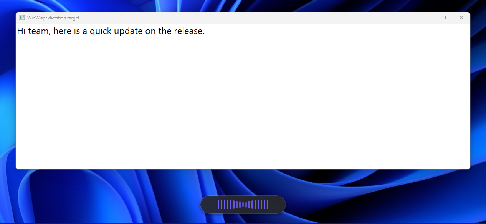
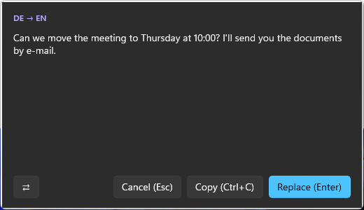
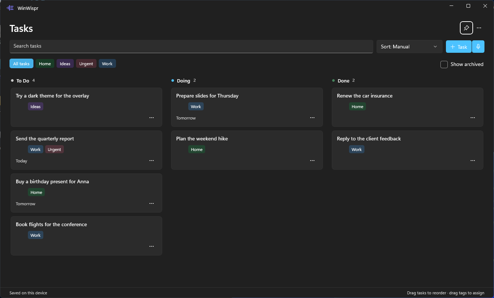

# WinWispr

WinWispr is a local dictation tool for Windows 11. Hold a hotkey, speak, and the
text appears in the active window. Speech is recognized on your machine with
Parakeet TDT 0.6B V3 INT8; nothing is sent to the cloud. WinWispr also translates
between German and English offline and keeps a small task board you can dictate
into.



## Features

- **Dictation into any app.** Press or hold `Shift + Alt + X`, speak, and the
  transcript is pasted into the window you were typing in.
- **Offline German ↔ English translation.** Select text and press
  `Ctrl + Alt + E` for a translation preview, or hold `Shift + Alt + E` to speak
  German and get English text.
- **Task board.** A To Do → Doing → Done board with tags, due dates, search and
  Markdown descriptions. Dictate a task with `Ctrl + Alt + T`; it opens as a
  preview and is saved only after you review it.
- **Personal dictionary and voice commands.** Fix recurring recognition errors
  and dictate paragraphs, line breaks and bullet points.
- **Private by design.** Audio, transcripts and clipboard contents stay on your
  machine, and no dictation history is written to disk.





## Installation

### Requirements

- Windows 11, x64, build 22000 or later
- A microphone
- No internet access required once WinWispr Models is installed. The speech model and the German–English translation model come from that installer; with it, WinWispr downloads nothing for dictation or translation. Only the optional [update check](#updating) contacts GitHub

### Setup

1. Download from the [releases](https://github.com/cryptedx/WinWisper/releases) page and install WinWispr: run
   `WinWispr-Setup-vX.Y.Z.exe`, or extract `WinWispr-portable-vX.Y.Z.zip` to a
   permanent folder such as `%LOCALAPPDATA%\Programs\WinWispr`.
2. Run `WinWispr-Models-vN.exe` from the latest `models-vN` release. It finds an
   installation made with Setup by itself; for a portable copy, choose the
   folder you extracted.
3. Start WinWispr from the Start menu, or run `WinWispr.exe` from the folder.
4. Right-click the WinWispr tray icon and open **Settings**.
5. Open **Model** and wait for **Ready**.
6. Select your microphone and recording mode.

Audio and speech recognition stay local. WinWispr does not upload audio,
transcripts, or clipboard contents to the cloud, and with WinWispr Models
installed it needs no network access for dictation or translation. The only
network request is the [update check](#updating), which you can turn off.

### WinWispr Models

`WinWispr-Models-vN.exe` (about 870 MB) holds the speech model, the
German–English translation model (`TranslationData\`) and the offline voices.
It installs them next to `WinWispr.exe` and gets a new version only when a model
changes, so install it once and again only when a new `models-vN` release
appears. Updating WinWispr with a new Setup or portable ZIP keeps the installed
models. The Models installer has its own entry under **Settings → Apps →
Installed apps**, and uninstalling WinWispr removes it too.

Without WinWispr Models, **Settings → Model** can still download the speech
model from its pinned source, but translation reports *Translation not installed*.

### Signature and certificate trust

WinWispr's executables and installers are signed with WinWispr's own
self-signed code-signing certificate (subject `CN=WinWispr`, SHA-1 thumbprint
`F8D419ED06D2038754C6BB2E5042BBF6DBE5903C`, valid until 2036-10-11) and an
RFC 3161 timestamp. The public certificate is
[`eng/signing/WinWispr-CodeSigning.cer`](eng/signing/WinWispr-CodeSigning.cer).

Windows shows *WinWispr* as the verified publisher only on a machine that
trusts this certificate. To trust it, run in an elevated PowerShell from a
checkout (`-Remove` takes the trust away again):

```powershell
powershell -ExecutionPolicy Bypass -File eng\Trust-CodeSigningCertificate.ps1
```

The script checks the certificate against the pinned thumbprint and imports it
into the machine's **Trusted Root Certification Authorities** and **Trusted
Publishers** stores. This confirms that the files were signed with the WinWispr
key and not changed since. It is not a public certificate authority signature
and gives no SmartScreen reputation, so SmartScreen can still warn on download.
A trusted root also lets its key holder sign other code, so trust it only on
machines where you accept that.

## Updating

WinWispr checks for a newer version 30 seconds after it starts and then every
24 hours. It anonymously reads the latest release of the public GitHub
repository `cryptedx/WinWisper`; model releases (`models-vN`) are ignored. The
request carries only a `User-Agent` with the WinWispr version, and no telemetry
is sent. Turn the automatic check off with **Settings → General → Check for
updates automatically**; **Check for updates** in the tray menu and on the
General page checks on demand.

When a newer version exists, a tray balloon says *WinWispr X.Y.Z is available.
Click to update.* Nothing is downloaded before you click it. Then WinWispr:

1. downloads `WinWispr-Setup-vX.Y.Z.exe` and its `.sha256` sidecar to
   `%LOCALAPPDATA%\WinWispr\Updates\vX.Y.Z\`;
2. checks that the file's SHA-256 matches the sidecar and the digest GitHub
   reports, that its signature is intact and that it is signed with the pinned
   WinWispr certificate (see [Signature and certificate trust](#signature-and-certificate-trust));
   if any check fails, nothing is installed;
3. quits and runs Setup silently into the same folder: a per-user installation
   updates without a prompt, a per-machine installation shows one UAC prompt;
4. starts the new version again.

Settings, the personal dictionary and installed models are kept. A portable
copy is not changed in place; the balloon opens the release page, where you
download the new ZIP and extract it over the folder (see [Setup](#setup)).
Administrators can disable both the automatic and the manual check with the
DWORD value `DisableUpdateCheck` = `1` under `HKLM\Software\Policies\WinWispr`;
see [`docs/ENTERPRISE-SECURITY.md`](docs/ENTERPRISE-SECURITY.md). The WinWispr
Models installer is not part of this check: install a new `models-vN` release
yourself when one appears.

## Usage

### Hotkeys

| Action | Default hotkey |
| --- | --- |
| Dictate | `Shift + Alt + X` |
| Translate the selection | `Ctrl + Alt + E` |
| Dictate German as English | `Shift + Alt + E` |
| Paste the last result again | `Ctrl + Alt + V` |
| Open the task board | `Ctrl + Alt + B` |
| Dictate a task | `Ctrl + Alt + T` |

All hotkeys can be changed in **Settings**. The tray menu provides
**Settings**, **Start/Stop**, **Translate clipboard**, **Task board**,
**Check for updates**, and **Exit**.

### Dictation

| Mode | Usage |
| --- | --- |
| **Toggle** | Press the hotkey, speak, then press the hotkey again. |
| **Hold** | Hold the hotkey, speak, then release it. |
| **Overlay** | Select **Transcribe** or **Stop** while recording. |
| **Cancel** | Press `Esc`, then press `Y` during the countdown to discard. |

After pasting, WinWispr restores your previous clipboard contents unless
something else was copied in the meantime. If a paste does not land, click the
target field and press `Ctrl + Alt + V`. The last result is kept in memory only
until WinWispr exits.

**Personal dictionary.** In **Settings → Dictation text**, add one
`recognized term = desired text` per line, for example `Win Whisper = WinWispr`.
Whole terms are replaced case-insensitively, and longer matches win.

**German voice commands** (off by default) turn `neuer Absatz` (new paragraph),
`neue Zeile` (new line), `Aufzählung` (bullet) and `Doppelpunkt` (colon) into
formatting.

### Translation

Both translation flows run fully offline and are designed to finish within
three seconds.

- **Selection translation:** select text in any app and press `Ctrl + Alt + E`.
  WinWispr detects whether it is German or English and shows the translation in
  a preview. **Replace** (`Enter`) pastes it over the selection, **Copy**
  (`Ctrl + C`) puts it on the clipboard, **Cancel** (`Esc`) closes the preview,
  and ⇄ translates in the other direction. Selections up to 3,000 characters
  are supported; formatting is not kept.
- **Translate clipboard** in the tray menu translates the text already on the
  clipboard.
- **English dictation:** hold `Shift + Alt + E`, speak German, and WinWispr
  pastes the English translation directly, without a preview.

Check important text: terminology and idioms can be translated wrongly.

### Task board

Open the board with `Ctrl + Alt + B` or from the tray menu. Tasks have titles,
Markdown descriptions, tags and due dates, and can be searched, filtered,
sorted, dragged between columns, archived and restored. Dictating a task never
pastes into another app; it opens a preview, and the task is saved only after
you review it. On the first use of a day, WinWispr reminds you of tasks that are
due or overdue.

## Data and privacy

Settings, models, tasks and technical logs are stored in
`%LOCALAPPDATA%\WinWispr`. Tasks live in `tasks.json` there, with a backup and a
recovery copy. WinWispr writes no dictation history to disk.
**Settings → Startup → Start with Windows** uses a per-user registry entry and
needs no administrator rights. The uninstaller asks whether to delete the app
data; the default keeps it.

See [`SECURITY.md`](SECURITY.md) and
[`docs/ENTERPRISE-SECURITY.md`](docs/ENTERPRISE-SECURITY.md) for the security
policy, data inventory and network boundary.

## Building from source

WinWispr is built with C#, .NET 10, WinUI 3 and Windows App SDK 2.4, with local
speech recognition through sherpa-onnx 1.13.5. It targets x64 only and runs
unpackaged. On Windows, from the repository root in PowerShell:

```powershell
dotnet restore WinWispr.sln --locked-mode
powershell.exe -ExecutionPolicy Bypass -File .\eng\Build-SherpaRuntime.ps1
dotnet build WinWispr.sln -c Release -p:Platform=x64 --no-restore
$runner = Get-ChildItem .\tests\WinWispr.Tests\bin\x64\Release -Recurse -Filter WinWispr.Tests.exe
& $runner.FullName --filter 'TestCategory!=WindowsAcceptance'
```

| Path | Contents |
| --- | --- |
| `src/WinWispr/` | WinUI application, tray, overlay, settings and task board |
| `src/WinWispr/Speech/` | Speech model installation, model manifests and speech runtime |
| `src/WinWispr/Translation/` | Offline German–English translation |
| `tests/WinWispr.Tests/` | Unit, contract and end-to-end tests |
| `eng/` | Build, packaging, signing and release scripts |

Third-party components and their licenses are listed in
[`THIRD-PARTY-NOTICES.md`](THIRD-PARTY-NOTICES.md).
